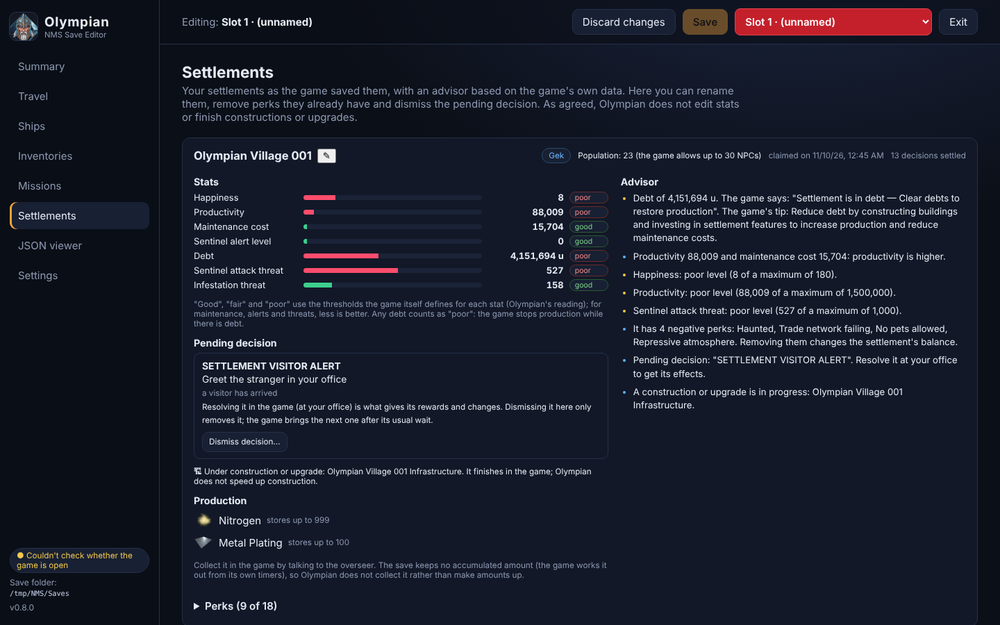
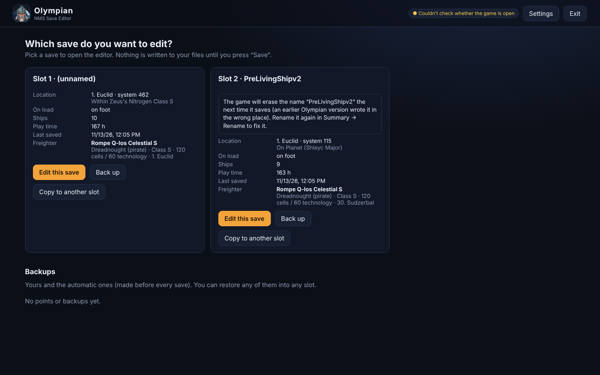
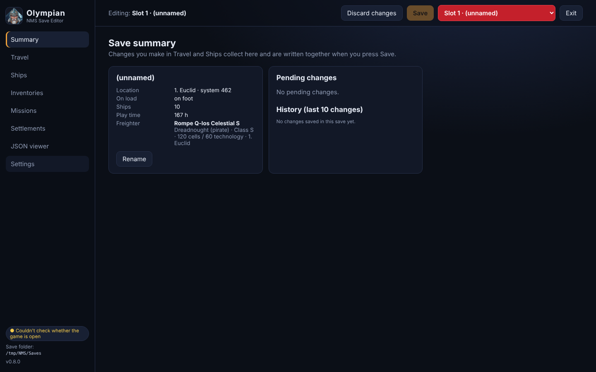
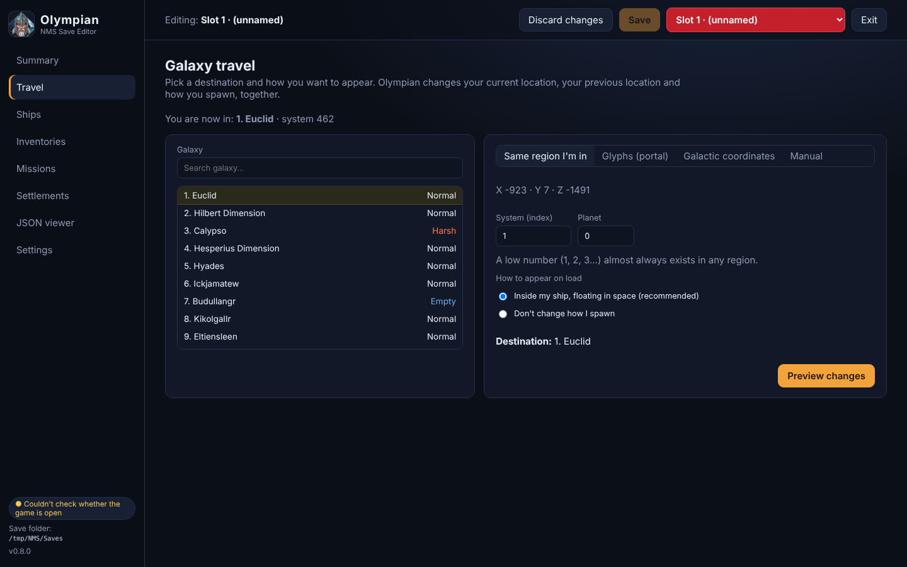
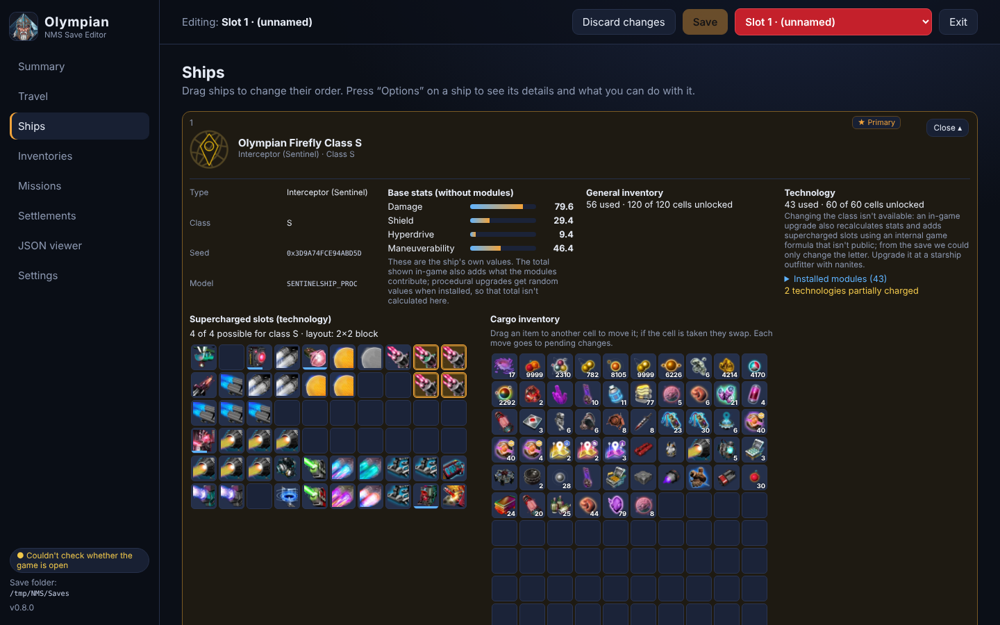
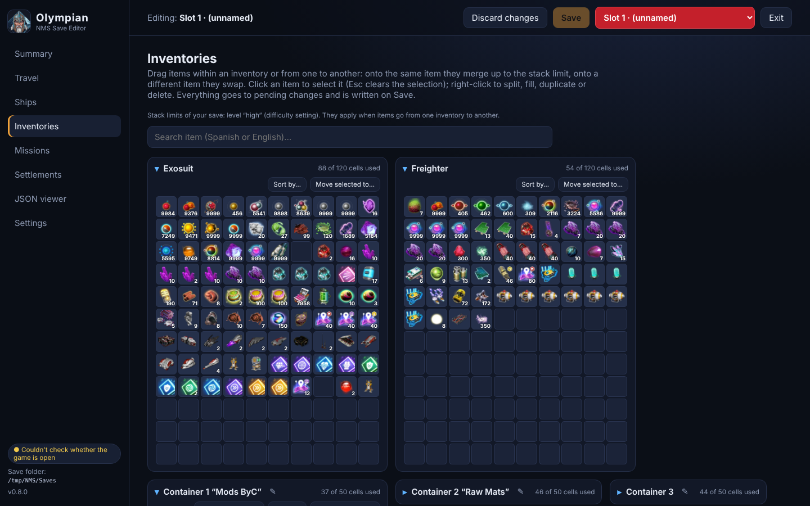
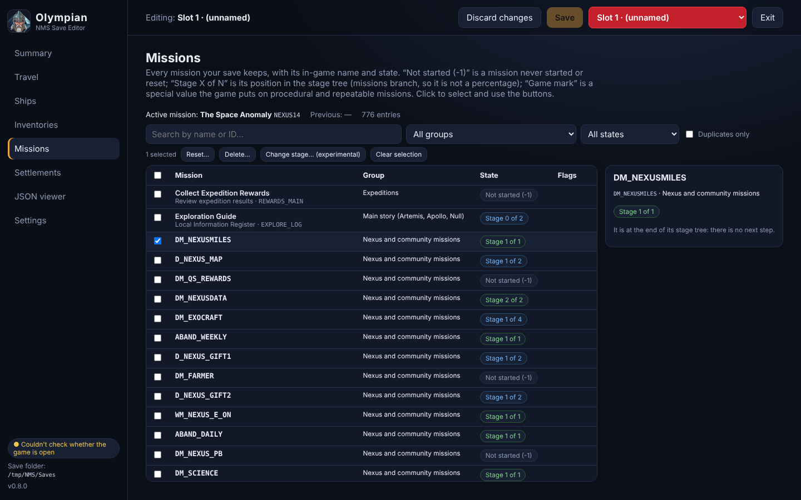
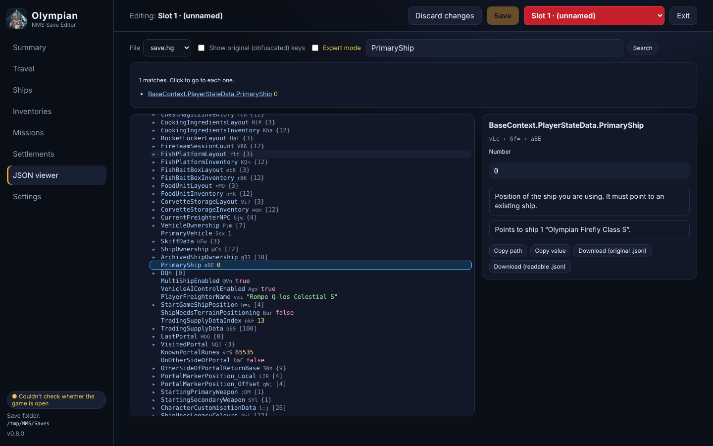

<p align="center"></p>

<h1 align="center">Olympian NMS Save Editor</h1>

<p align="center">Un editor de partidas de <b>No Man's Sky</b> para Windows, visual y cuidadoso.<br>
Cada cambio se muestra antes, se verifica byte por byte y solo se escribe después de un respaldo automático.</p>

<p align="center"><a href="README.md">Read in English</a> · <a href="FAQ.es.md">Preguntas frecuentes</a> · <a href="CHANGELOG.md">Cambios (en inglés)</a></p>



## Novedades en 0.9.0

- **Protección opcional con PIN + código 2FA** (Google/Microsoft Authenticator, Authy…): se pide al abrir Olympian y otra vez en las acciones destructivas. Funciona sin internet y sin cuenta. O la opción **"Vivo solo"** si no compartes la PC.
- **Primero tu guardado manual:** Olympian muestra y edita la partida que guardaste tú (al bajar de la nave o en un punto de guardado); el autoguardado solo cambia si tiene los mismos datos.
- **Inicio:** eliminar partidas (siempre con respaldo completo antes), espacio que ocupan los respaldos con **purga** que conserva los 10 más recientes, **copia opcional de cada respaldo fuera de la carpeta de partidas**, y un botón con el ícono de la computadora de base del juego para volver aquí desde cualquier lugar.
- **Resumen con íconos:** raza, unidades, nanitos, plata de quásar, reputación, nave principal, carguero, exovehículos, corbetas y la multiherramienta en uso.
- **Naves:** una sola cabecera con las acciones como íconos; reparar módulos dañados y **celdas dañadas de naves rescatadas** como lo hace el juego; carga visible en cada celda; **marcos de adyacencia** en la cuadrícula de tecnología; **tooltips con la descripción del propio juego** y los rangos de las mejoras; expandir la tecnología a 60 celdas cuando la nave ya tiene sus 4 supercargadas; **copiar o mover una nave a otras partidas**; **historial de seeds**.
- **Asentamientos:** cuadrícula de los **48 lotes** con su clase, mejoras en curso (engranaje dorado), mejoras listas para completar (✔ verde) y edificios nuevos en construcción.
- **Misiones** con el mismo título, agrupadas. Diseño proporcional: las cuadrículas crecen y se achican con la ventana.

Lista completa en el [CHANGELOG](CHANGELOG.md).

## Por qué Olympian

La mayoría de los editores te dejan cambiar cualquier cosa. Olympian se enfoca en cambiar las cosas **de forma segura** y en explicar qué hace cada cambio:

- **Cambios pendientes y luego Guardar.** Nada toca tus archivos hasta que pulsas *Guardar*. Cada acción muestra primero "esto es lo que va a pasar".
- **Respaldo automático antes de cada escritura**, con la lista de lo que se cambió. Solo se borra si tú lo purgas, y los 10 más recientes se conservan siempre. Cualquier respaldo se puede restaurar en cualquier slot.
- **Cambios fieles al byte.** Olympian reescribe solo los bytes de lo que cambiaste; el resto del archivo queda idéntico. Cada cambio se comprueba: fuera de la parte editada no cambió nada y la parte editada se lee exactamente como se pretendía. Después de escribir, el archivo se vuelve a leer como lo leería el juego.
- **Reglas del juego incorporadas.** Límites de pila, qué tecnología va dónde, una tecnología de cada tipo y hasta tres módulos de mejora del mismo tipo, tomados de los archivos de *tu* juego.
- **Límites acordados.** Algunas cosas no se ofrecen a propósito porque rompen la experiencia o dañan partidas (cambiar la clase de una nave, editar estadísticas de asentamientos, terminar construcciones al instante…).

## Funciones

| Sección | Qué puedes hacer |
|---|---|
| **Inicio** | Elegir partida, respaldar cualquier slot, copiar un slot a otro, restaurar cualquier respaldo en cualquier slot, eliminar partidas (con protección). Espacio que ocupan los respaldos y purga de los antiguos. |
| **Resumen** | Datos de la partida, renombrarla, últimos 10 cambios con "volver a antes de este cambio". Economía, reputación, nave principal, carguero, exonave, corbetas y arma principal, con enlace a su ventana. |
| **Viaje** | Las 256 galaxias; destino por glifos, coordenadas galácticas o manual; aparecer dentro de tu nave flotando en el espacio. |
| **Naves** | Reordenar arrastrando, elegir la nave principal, renombrar, reparar módulos dañados (uno o todos), habilitar celdas, recargar, expandir la carga al máximo de su clase (y la tecnología a 60 cuando la nave ya tiene sus 4 celdas supercargadas), cambiar seed (o copiar el de otra nave del mismo modelo), copiar módulos de otra nave, duplicar, eliminar. Mapa de celdas supercargadas y marcos de bonificación por adyacencia. Corbetas y naves vivientes solo muestran las acciones seguras para ellas. |
| **Inventarios** | Exotraje, carguero, 10 contenedores, almacén de corbeta, carga de exonaves y de naves en una pantalla. Arrastrar entre inventarios, juntar pilas, ordenar por nombre/rareza/valor, "mover aquí todos los…" por categoría, buscador con totales, dividir/llenar/duplicar/borrar pilas, agregar objetos en celdas vacías. Tecnología instalada del exotraje, carguero y multiherramientas: instalar, desinstalar, mover. |
| **Misiones** | Todas las misiones con su nombre del juego, grupo y estado. Reiniciar (opcionalmente el resto de su serie), borrar entradas atascadas o duplicadas, cambiar etapa (experimental). Cuadro lateral con "qué hacer ahora / después" tomado de los textos de objetivos del juego. Las misiones que comparten título aparecen agrupadas. |
| **Asentamientos** | Solo los tuyos: estadísticas, perks con su efecto exacto, decisión pendiente, producción, construcción en curso y los 48 lotes con su clase y las mejoras en curso. Renombrar, quitar perks existentes, descartar la decisión pendiente. Asesor con datos del juego (deuda, estadísticas débiles y qué perks las causan…) y las rutas de misiones de asentamientos con tu avance. |
| **Visor JSON** | Toda la partida en un árbol con nombres legibles, nombre del objeto junto a cada ID, buscador, notas de qué es cada campo y qué riesgo tiene editarlo, dependencias, exportar. **Modo experto** opcional para cambiar valores sueltos (mismo tipo, verificado como todo lo demás). |

Idiomas: la interfaz en **español o inglés**, y los términos del juego por separado en inglés, español de Latinoamérica o español de España.

## Capturas

| | |
|---|---|
|  |  |
|  |  |
|  |  |
|  |  |

## Requisitos

- **Windows 11** (Windows 10 puede funcionar, pero no está probado), versión de PC de No Man's Sky (probado con **Steam**; también detecta la carpeta de GOG).
- Microsoft Edge (viene con Windows): Olympian se abre en una ventana tipo app de Edge.
- Python 3.11+: si falta, se instala solo la primera vez (Python 3.13 oficial, solo para tu usuario, con `winget`).

**No** se admiten partidas de consola (PlayStation, Xbox, Switch) ni el formato de Xbox / Game Pass para PC.

## Lo que hace y lo que no hace Olympian NMS Save Editor

Todo mod o editor cambia el juego, y Olympian NMS Save Editor no es la excepción. Lo que lo distingue no es una superioridad moral, sino estos compromisos de seguridad:

1. **Solo presentará resultados que el juego podría producir por sí mismo**, siguiendo sus propias reglas y límites. Nunca dejará tu partida en un estado imposible.
2. **Solo modificará aquello que se sabe con certeza; no destruirá tus saves.** No aplicará funciones experimentales de alto riesgo: ya el riesgo lo corremos por ti, con pruebas reales continuamente monitoreadas. De todo lo demás podremos mostrarte una lectura, pero hasta no definir un método seguro, no ofreceremos edición.
3. **Tratará de mantener tu experiencia del juego lo más fiel posible** (sin dejar de ofrecer mejoras opcionales). Verás que ofrece herramientas para resolver problemas reales, no atajos para "tenerlo todo".
4. **Pondrá tu seguridad primero:** respaldos antes de cualquier cambio a tu partida, lo mínimo invasivo posible y avisos claros cuando algo tenga riesgo.
5. **Será transparente:** código abierto, sin relación con Hello Games, y explicará qué hace y qué no hace cada función.

## Instalar y abrir

1. Descarga el último `OlympianNMSSaveEditor_vX.Y.Z.zip` desde [Releases](../../releases) y **descomprímelo** (por ejemplo en `Documentos\Olympian`). No lo ejecutes desde dentro del zip.
2. Doble clic en **`run_olympian_nmsse.bat`**.
   - La primera vez prepara su entorno (1 a 3 minutos). Después abre al instante.
   - También crea, junto al `.bat`, el acceso directo **"Olympian NMS Save Editor"** con el icono de la app; cópialo al escritorio o ánclalo a la barra de tareas.
3. **Cierra el juego antes de guardar.** Olympian lo comprueba y no escribe si está abierto.
4. **Steam Cloud:** después de guardar, abre el juego primero en *este* PC para que Steam suba la versión nueva.

**Actualizar a una versión nueva:** cada zip trae su carpeta con la versión en el nombre (`OlympianNMSSaveEditor_v0.9.0`). Descomprímela como una carpeta nueva, ábrela con su `.bat` y, cuando veas que funciona, borra la carpeta vieja. Tus ajustes, la protección y los respaldos no viven en la carpeta de la app, así que no se pierden. Descomprimir encima de la versión anterior también funciona, pero puede dejar archivos viejos que ya no se usan.

SmartScreen o tu antivirus pueden avisar porque el `.bat` no está firmado: *Más información → Ejecutar de todas formas*. Olympian solo abre un servidor local en `127.0.0.1` con una clave por sesión y no se conecta a internet.

## Dónde se guardan las cosas

Dentro de tu carpeta de partidas (`%APPDATA%\HelloGames\NMS\st_<id>`):

- `_OlympianBackups\<fecha>_<acción>\`: respaldos automáticos (uno antes de cada guardado) y `history.json`.
- `_OlympianRestorePoints\`: respaldos que creas tú.

Fuera de la carpeta de la app, en `%APPDATA%\OlympianNMS\`: ajustes (`settings.json`), protección con PIN y código (`lock.json`; el PIN solo como verificador y el secreto cifrado) y los lotes de asentamientos que Olympian va aprendiendo (`lots.json`). Si eliges una carpeta extra para respaldos, cada respaldo se copia también a `<carpeta extra>\OlympianNMS_<carpeta de partidas>\`.

Dentro de la carpeta de la app: el entorno de Python (`.venv`, se vuelve a crear si falta) y el registro `olympian_log.txt` junto al `.bat`.

Las carpetas de las versiones hasta la 0.7.0 (`_ZeusRespaldos`, `_ZeusPuntos`) se mueven solas a los nombres nuevos la primera vez que abres la carpeta de partidas; no se pierde ningún respaldo.

## Datos del juego y actualizaciones

Los nombres, iconos, límites de pila, tablas de misiones y reglas de asentamientos vienen de los archivos del propio juego (`olympian/data/gamedata.json`, `olympian/data/icons.zip`), generados con [`tools/build_gamedata.py`](tools/build_gamedata.py) (HGPAKtool + MBINCompiler). Olympian guarda la huella de los archivos del juego y **Ajustes** te avisa cuando los datos quedan desactualizados tras un parche.

Para regenerarlos tú mismo:

```bat
pip install hgpaktool
python tools\build_gamedata.py "<NMS>\GAMEDATA\PCBANKS" "<ruta a MBINCompiler.exe>" olympian\data\gamedata.json
```

## Para desarrolladores

```bat
python -m olympian            :: abrir (con ventana)
python -m olympian --check    :: autoprueba del entorno
python -m pytest tests        :: pruebas
```

- `olympian/core/`: formato de la partida (`hgfile`, `savefile`, `meta`), edición fiel al byte (`jspan`, `pathedit`), cada sección del editor y la red de seguridad (`safety`, `session`, `ops`).
- `olympian/web/`: la interfaz (HTML/CSS/JS sin compilación) y sus textos (`i18n/en.json`, `i18n/es.json`).
- La mayoría de las pruebas usan copias de partidas reales en `tests/fixture/`. Las partidas son personales, así que **no** están en este repositorio; pon copias de tu propia carpeta de partidas ahí para correr todas las pruebas (si no, las que las necesitan se saltan).

Los reportes de errores son bienvenidos en [Issues](../../issues): adjunta `olympian_log.txt` y cuenta qué hiciste.

## Apoya el proyecto

Olympian es gratis. Si te ahorró horas de grindeo (o una partida), puedes invitarle un café a MightyZeus:
**[paypal.me/ImMightyZeus](https://paypal.me/ImMightyZeus)**. Cualquier monto ayuda a mantenerlo al día después de cada parche del juego. ¡Gracias!

## Créditos

**Desarrollado por MightyZeus, de Nicaragua 🇳🇮.**

```
Olympian NMS Save Editor — Copyright © 2026 MightyZeus · Licencia GPL-3.0
Apoya el proyecto: https://paypal.me/ImMightyZeus · Repositorio: https://github.com/ImMightyZeus/Olympian-NMS-Save-Editor

Agradecimientos:
A mi querida esposa y mi amada familia, por permitirme seguir siendo un niño aun en mi adultez.
Pangro Daer Barun D'Gross, por seguirme corrompiendo con videojuegos.
Fenrir, porque aunque ya casi no juega, aún se presta a conversar sobre mis aventuras y desventuras.
```

Hecho sobre el trabajo de la comunidad de modding de No Man's Sky:

- [libNOM.map](https://github.com/zencq/libNOM.map) de zencq: mapa de las claves ofuscadas de la partida (GPL-3.0; `olympian/data/mapping_mbincompiler.json`).
- [MBINCompiler](https://github.com/monkeyman192/MBINCompiler) (LGPL-3.0) y [HGPAKtool](https://github.com/monkeyman192/HGPAKtool) (MIT) de monkeyman192 y colaboradores: lectura de los archivos de datos del juego.
- [lz4](https://github.com/python-lz4/python-lz4) (BSD): compresión de las partidas (incluido para Windows).
- [QR Code Generator](https://github.com/kazuhikoarase/qrcode-generator) de Kazuhiko Arase (MIT): el código QR para configurar la protección (`olympian/web/vendor/qrcode.js`).
- El conocimiento compartido por la comunidad alrededor de [NomNom](https://github.com/zencq/NomNom) y el [NMSSaveEditor de goatfungus](https://github.com/goatfungus/NMSSaveEditor), que permitió entender el formato de las partidas.

## Aviso

Olympian es una herramienta hecha por un fan, **sin relación con Hello Games ni respaldada por ellos**. *No Man's Sky* es una marca de Hello Games. Los textos, datos e iconos del juego incluidos en `olympian/data/` pertenecen a Hello Games y se incluyen solo para usarlos con tu propia copia del juego. Editar partidas es bajo tu propio riesgo: Olympian hace un respaldo antes de cada escritura, pero guarda también tus propias copias de las partidas importantes.

## Divulgación sobre el uso de IA

El uso de nuevas tecnologías forma parte del día a día de este y de otros proyectos de MightyZeus. Olympian NMS Save Editor se desarrolla con la ayuda de una IA (Claude), que participa en la escritura y revisión del código; la dirección del proyecto, qué funciones entran y cuáles se dejan fuera a propósito, y las pruebas en el juego real son trabajo humano.

El compromiso de fondo no cambia: crear soluciones y herramientas reales desde la perspectiva de un jugador apasionado por disfrutar del juego y por ayudar a otros a hacerlo.

## Licencia

Copyright © 2026 MightyZeus.

Olympian es software libre publicado con la [Licencia Pública General de GNU v3.0](LICENSE): el mapa de claves de libNOM.map que se incluye es GPL-3.0, así que Olympian usa la misma licencia. Puedes usarlo, compartirlo y modificarlo según esa licencia; las versiones redistribuidas o modificadas deben conservar este aviso de copyright y seguir bajo la GPL-3.0.

## Otros proyectos de MightyZeus para No Man's Sky

- **Olympian NMS Save Editor**: editor de partidas seguro y visual (PC/Steam). https://github.com/ImMightyZeus/Olympian-NMS-Save-Editor
- **Olympian Planet Coords**: coordenadas del planeta en pantalla y destinos con marcador y flecha de dirección. https://github.com/ImMightyZeus/Olympian-Planet-Coords

Todos los proyectos: https://github.com/ImMightyZeus
