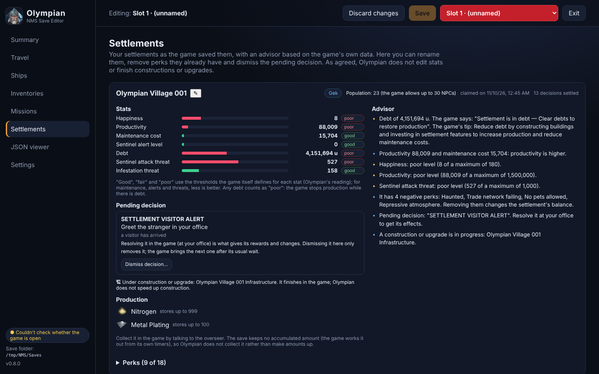
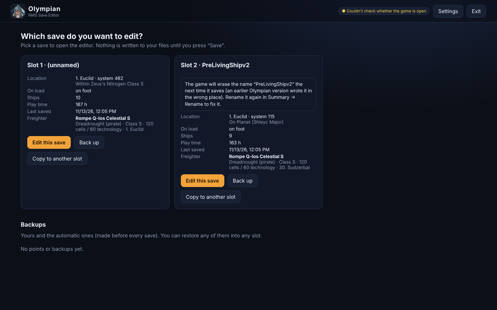
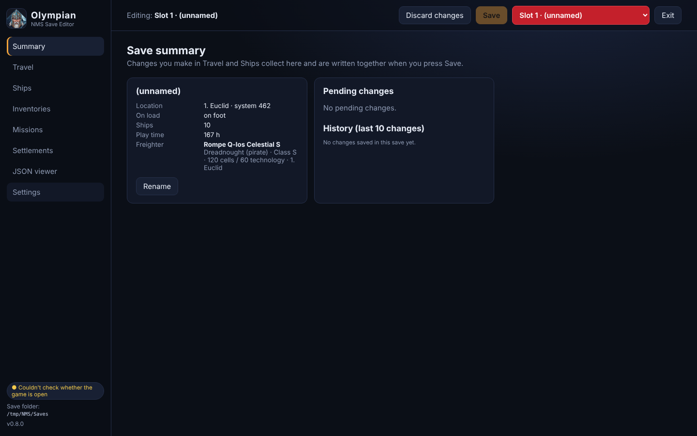
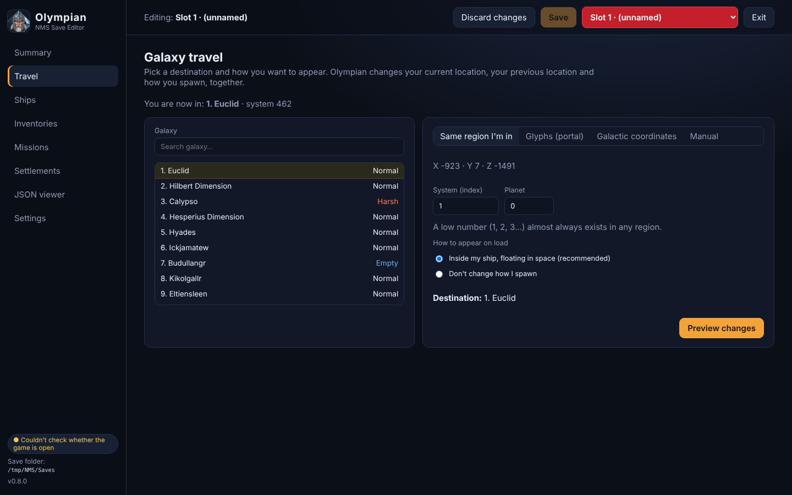
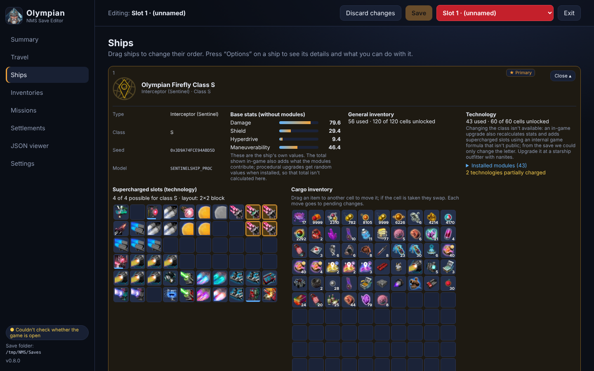
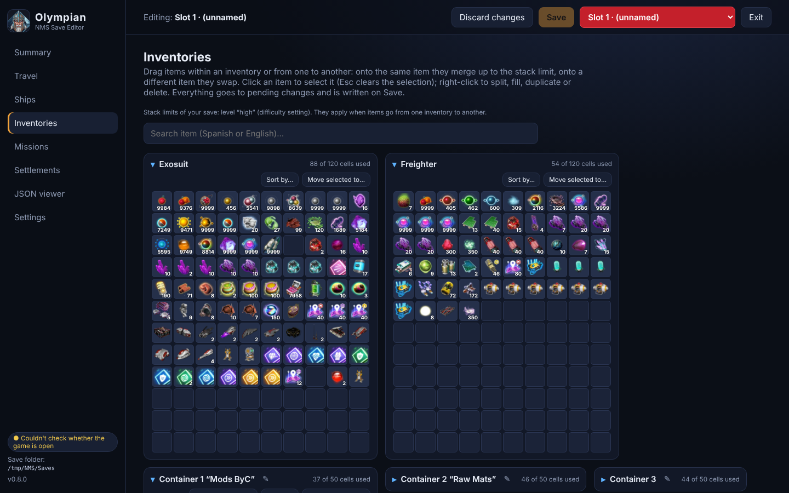
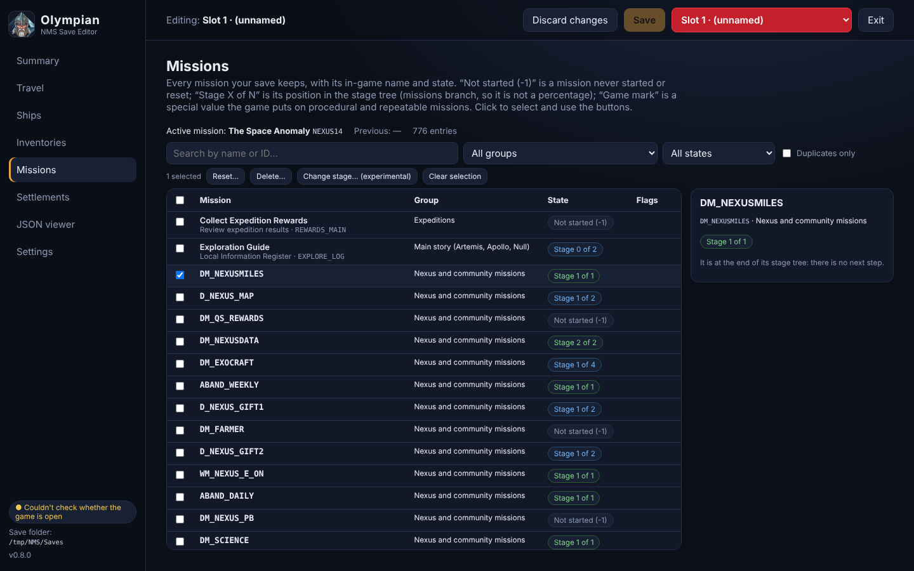
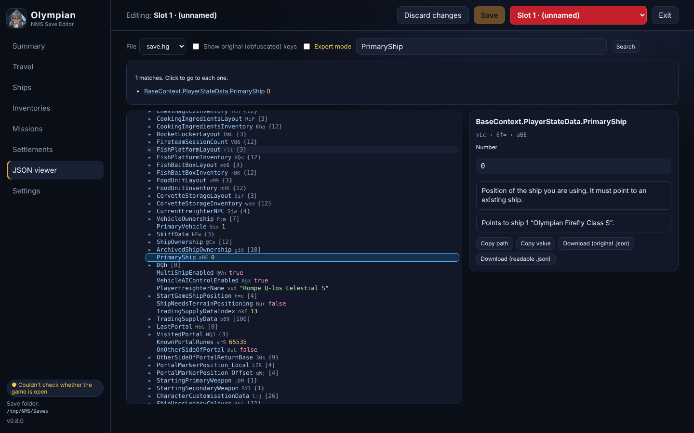

<p align="center"></p>

<h1 align="center">Olympian NMS Save Editor</h1>

<p align="center">A careful, visual save editor for <b>No Man's Sky</b> on Windows.<br>
Every change is previewed, verified byte by byte and written only after an automatic backup.</p>

<p align="center"><a href="README.es.md">Leer en español</a> · <a href="FAQ.md">FAQ</a> · <a href="CHANGELOG.md">Changelog</a></p>



## What's new in 0.9.0

- **Optional PIN + 2FA code protection** (Google/Microsoft Authenticator, Authy…): asked when Olympian opens and again for destructive actions. Works offline and without an account. Or the **"I live alone"** option if you do not share the PC.
- **Your manual save comes first:** Olympian shows and edits the save you made yourself (leaving the ship or at a save point); the autosave is only changed when it holds the same data.
- **Start:** delete saves (always with a full backup first), backup disk usage with a **purge** that keeps the newest 10, an **optional copy of every backup outside the save folder**, and a button with the game's base computer icon to come back here from anywhere.
- **Summary with icons:** race, units, nanites, quicksilver, reputation, primary ship, freighter, exocraft, corvettes and the multi-tool in hand.
- **Ships:** one header with the actions as icons; repair damaged modules and **damaged cells of salvaged ships** as the game does; charge visible in each cell; **adjacency frames** in the technology grid; **tooltips with the game's own description** and upgrade ranges; expand technology to 60 cells when the ship already has its 4 supercharged cells; **copy or move a ship to other saves**; **seed history**.
- **Settlements:** a grid of the **48 lots** with their class, upgrades in progress (gold cog), upgrades ready to complete (green check) and new buildings under construction.
- **Missions** sharing a title are grouped. Proportional layout: grids grow and shrink with the window.

Full list in the [CHANGELOG](CHANGELOG.md).

## Why Olympian

Most save editors let you change anything. Olympian focuses on changing things **safely** and explaining what each change does:

- **Pending changes, then Save.** Nothing touches your files until you press *Save*. Each action shows "this is what will happen" first.
- **Automatic backup before every write**, with a list of what was changed in it. It is only deleted if you purge it, and the newest 10 are always kept. Any backup can be restored into any slot.
- **Byte-faithful edits.** Olympian rewrites only the bytes of what you changed; everything else in the file stays identical. Every change is checked: outside the edited part nothing changed, and the edited part reads back exactly as intended. After writing, the file is read again the way the game reads it.
- **Game rules built in.** Stack limits, which technology fits where, one technology of each kind and up to three upgrade modules per kind — taken from *your own* game files.
- **Agreed limits.** Some things are deliberately not offered because they break the game experience or corrupt saves (changing a ship's class, editing settlement stats, finishing constructions instantly…).

## Features

| Section | What you can do |
|---|---|
| **Start** | Pick a save, back up any slot, copy a slot to another, restore any backup into any slot (*Restore to…*), delete saves (with protection). Backup disk usage and purge of old ones. |
| **Summary** | Save overview, rename the save, last 10 changes with "go back to before this change". Economy, reputation, primary ship, freighter, exocraft, corvettes and main weapon, each linked to its view. |
| **Travel** | All 256 galaxies; destination by portal glyphs, galactic coordinates or manually; appear inside your ship floating in space. |
| **Ships** | Reorder by dragging, choose the primary ship, rename, repair damaged modules (one or all), enable cells, recharge, expand cargo to the class maximum (and technology to 60 once the ship already has its 4 supercharged cells), change seed (or copy another ship's of the same model), copy modules from another ship, duplicate, delete. Supercharged-slot map and adjacency-bonus frames. Corvettes and living ships only show the actions that are safe for them. |
| **Inventories** | Exosuit, freighter, 10 storage containers, corvette storage, exocraft and ship cargo on one screen. Drag between inventories, merge stacks, sort by name/rarity/value, "move here all the…" by category, search with totals, split/fill/duplicate/delete stacks, add items on empty cells. Installed technology of the exosuit, freighter and multi-tools: install, uninstall, move. |
| **Missions** | Every mission with its in-game name, group and state. Reset (optionally the rest of its series), delete stuck or duplicated entries, change stage (experimental). Side panel with "what to do now / next" from the game's own objective texts. Missions sharing a title are grouped. |
| **Settlements** | Your settlements only: stats, perks with their exact effect, pending decision, production, construction in progress and the 48 lots with their class and upgrades in progress. Rename, remove existing perks, dismiss the pending decision. An advisor based on the game's data (debt, weak stats and which perks cause them…) and the known settlement mission routes with your progress. |
| **JSON viewer** | The whole save as a tree with readable key names, item names next to IDs, search, notes on what each field is and what editing it risks, computed dependencies, export. Optional **expert mode** to change single values (same type only, verified like everything else). |

Languages: the interface in **English or Spanish**, and game terms separately in English, Latin-American Spanish or Spain Spanish.

## Screenshots

| | |
|---|---|
|  |  |
|  |  |
|  |  |
|  |  |

## Requirements

- **Windows 11** (Windows 10 may work but is not tested), PC version of No Man's Sky (tested with **Steam**; the GOG save folder is also detected).
- Microsoft Edge (included with Windows) — Olympian opens in an app-style Edge window.
- Python 3.11+ — installed automatically the first time if missing (official Python 3.13, for your user only, via `winget`).

Console saves (PlayStation, Xbox, Switch) and the Xbox / Game Pass PC save format are **not** supported.

## What Olympian NMS Save Editor does and doesn't do

Every mod or editor changes the game, and Olympian NMS Save Editor is no exception. What sets it apart isn't moral superiority, but these safety commitments:

1. **It will only produce results the game could produce on its own**, following its own rules and limits. It will never leave your save in an impossible state.
2. **It will only change what is known with certainty; it will not destroy your saves.** It will not apply high-risk experimental features: we already take that risk for you, with real tests that are continuously monitored. For everything else we may show you a reading, but until a safe method is defined, we will not offer editing.
3. **It will try to keep your game experience as faithful as possible** (while still offering optional improvements). You'll see that it offers tools that solve real problems, not shortcuts to "have everything".
4. **It will put your safety first:** backups before any change to your save, as little intrusion as possible, and clear warnings when something carries risk.
5. **It will be transparent:** open source, not affiliated with Hello Games, and it will explain what each feature does and doesn't do.

## Install and run

1. Download the latest `OlympianNMSSaveEditor_vX.Y.Z.zip` from [Releases](../../releases) and **extract it** (for example into `Documents\Olympian`). Do not run it from inside the zip.
2. Double-click **`run_olympian_nmsse.bat`**.
   - The first time it prepares its environment (1–3 minutes). After that it opens immediately.
   - It also creates a shortcut **"Olympian NMS Save Editor"** with the app icon next to the `.bat`; copy it to your desktop or pin it to the taskbar.
3. **Close the game before saving.** Olympian checks and refuses to write while the game is running.
4. **Steam Cloud:** after saving, start the game on *this* PC first so Steam uploads the new version.

**Updating to a new version:** each zip has its folder with the version in its name (`OlympianNMSSaveEditor_v0.9.0`). Extract it as a new folder, open it with its `.bat` and, once it works, delete the old folder. Your settings, protection and backups do not live in the app folder, so nothing is lost. Extracting over the previous version also works, but it may leave old files that are no longer used.

Windows SmartScreen or your antivirus may warn because the `.bat` is not signed: *More info → Run anyway*. Olympian only runs a local server on `127.0.0.1` with a per-session key and does not connect to the internet.

## Where things are kept

Inside your save folder (`%APPDATA%\HelloGames\NMS\st_<id>`):

- `_OlympianBackups\<date>_<action>\` — automatic backups (one before every save) and `history.json`.
- `_OlympianRestorePoints\` — backups you create yourself.

Outside the app folder, in `%APPDATA%\OlympianNMS\`: settings (`settings.json`), PIN and code protection (`lock.json`; the PIN only as a verifier and the secret encrypted) and the settlement lots Olympian learns (`lots.json`). If you choose an extra backup folder, every backup is also copied to `<extra folder>\OlympianNMS_<save folder>\`.

Inside the app folder: the Python environment (`.venv`, rebuilt if missing) and the log `olympian_log.txt` next to the `.bat`.

Folders from versions up to 0.7.0 (`_ZeusRespaldos`, `_ZeusPuntos`) are moved to the new names automatically the first time you open the save folder; no backup is lost.

## Game data and game updates

Item names, icons, stack limits, mission tables and settlement rules come from the game's own files (`olympian/data/gamedata.json`, `olympian/data/icons.zip`), generated with [`tools/build_gamedata.py`](tools/build_gamedata.py) (HGPAKtool + MBINCompiler). Olympian stores the game's file fingerprint and **Settings** tells you when the data is out of date after a game patch.

To rebuild the data yourself:

```bat
pip install hgpaktool
python tools\build_gamedata.py "<NMS>\GAMEDATA\PCBANKS" "<path to MBINCompiler.exe>" olympian\data\gamedata.json
```

## For developers

```bat
python -m olympian            :: run (opens the window)
python -m olympian --check    :: environment self-test
python -m pytest tests        :: tests
```

- `olympian/core/` — save format (`hgfile`, `savefile`, `meta`), byte-faithful JSON spans (`jspan`, `pathedit`), every editor section and the safety net (`safety`, `session`, `ops`).
- `olympian/web/` — the interface (plain HTML/CSS/JS, no build step) and its texts (`i18n/en.json`, `i18n/es.json`).
- Most tests run against copies of real saves in `tests/fixture/`. Saves are personal, so they are **not** in this repository; put copies of your own save folder there to run the full suite (tests that need them are skipped otherwise).

Bug reports are welcome in [Issues](../../issues): please attach `olympian_log.txt` and say what you did.

## Support the project

Olympian NMS Save Editor is free. If it saved you some hours of grinding (or a save), you can buy MightyZeus a coffee:
**[paypal.me/ImMightyZeus](https://paypal.me/ImMightyZeus)** — any amount helps keep it updated after every game patch. Thank you!

## Credits

**Developed by MightyZeus, from Nicaragua 🇳🇮.**

```
Olympian NMS Save Editor — Copyright © 2026 MightyZeus · GPL-3.0 License
Support the project: https://paypal.me/ImMightyZeus · Repository: https://github.com/ImMightyZeus/Olympian-NMS-Save-Editor

Acknowledgements:
To my dear wife and my beloved family, for letting me keep being a kid even as an adult.
Pangro Daer Barun D'Gross, for continuing to corrupt me with video games.
Fenrir, because even though he hardly plays anymore, he's still up for talking about my adventures and misadventures.
```

Built on the work of the No Man's Sky modding community:

- [libNOM.map](https://github.com/zencq/libNOM.map) by zencq — mapping of the save's obfuscated keys (GPL-3.0; `olympian/data/mapping_mbincompiler.json`).
- [MBINCompiler](https://github.com/monkeyman192/MBINCompiler) (LGPL-3.0) and [HGPAKtool](https://github.com/monkeyman192/HGPAKtool) (MIT) by monkeyman192 and contributors — reading the game's data files.
- [lz4](https://github.com/python-lz4/python-lz4) (BSD) — save compression (bundled wheel for Windows).
- [QR Code Generator](https://github.com/kazuhikoarase/qrcode-generator) by Kazuhiko Arase (MIT) — the QR code to set up protection (`olympian/web/vendor/qrcode.js`).
- The community knowledge shared around [NomNom](https://github.com/zencq/NomNom) and [goatfungus' NMSSaveEditor](https://github.com/goatfungus/NMSSaveEditor), which made it possible to understand the save format.

## Disclaimer

Olympian is a fan-made tool, **not affiliated with or endorsed by Hello Games**. *No Man's Sky* is a trademark of Hello Games. Game texts, data and icons included in `olympian/data/` belong to Hello Games and are included only for use with your own copy of the game. Editing saves is at your own risk — Olympian makes a backup before every write, but keep your own copies of important saves too.

## AI Disclosure

New technologies are part of the everyday work behind this and other MightyZeus projects. Olympian NMS Save Editor is developed with the help of an AI (Claude), which takes part in writing and reviewing the code; the project's direction, which features go in and which are left out on purpose, and the testing in the real game are human work.

The underlying commitment doesn't change: building real solutions and tools from the perspective of a player who is passionate about enjoying the game and helping others do the same.

## License

Copyright © 2026 MightyZeus.

Olympian is free software released under the [GNU General Public License v3.0](LICENSE) — the bundled key mapping from libNOM.map is GPL-3.0, so Olympian uses the same license. You may use, share and modify it under that license; redistributed or modified versions must keep this copyright notice and stay under the GPL-3.0.
