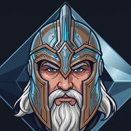
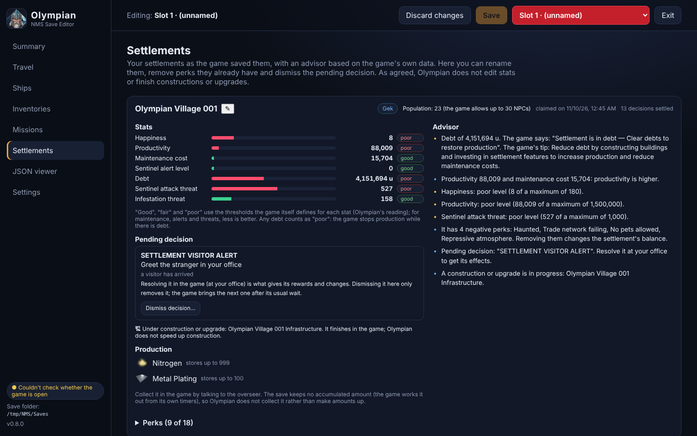
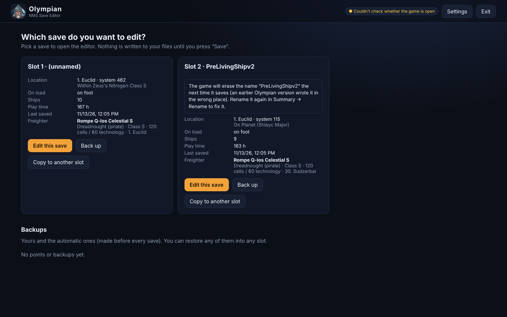
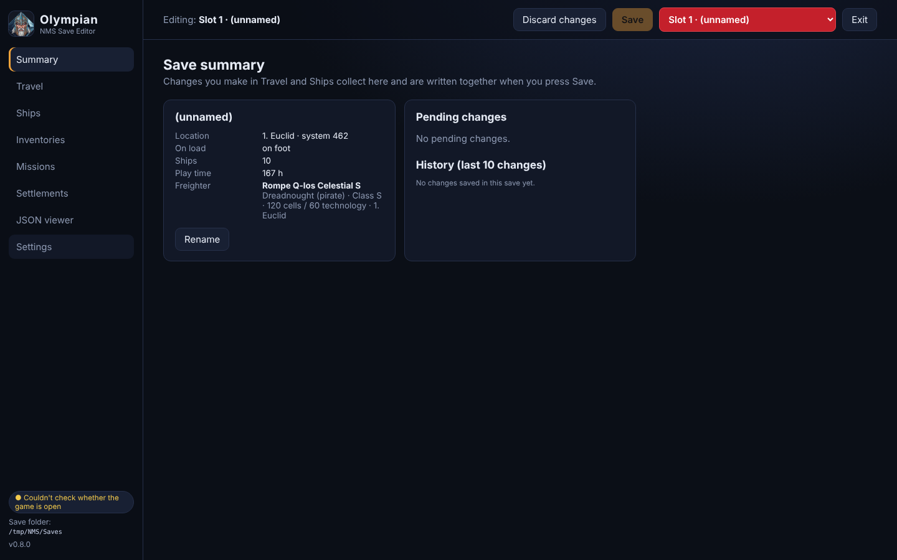
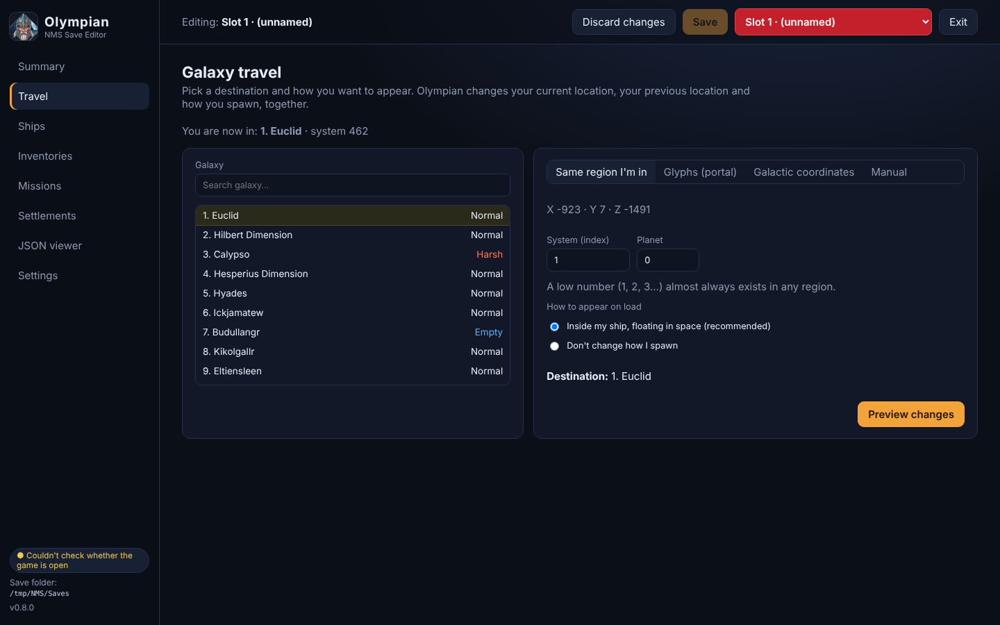
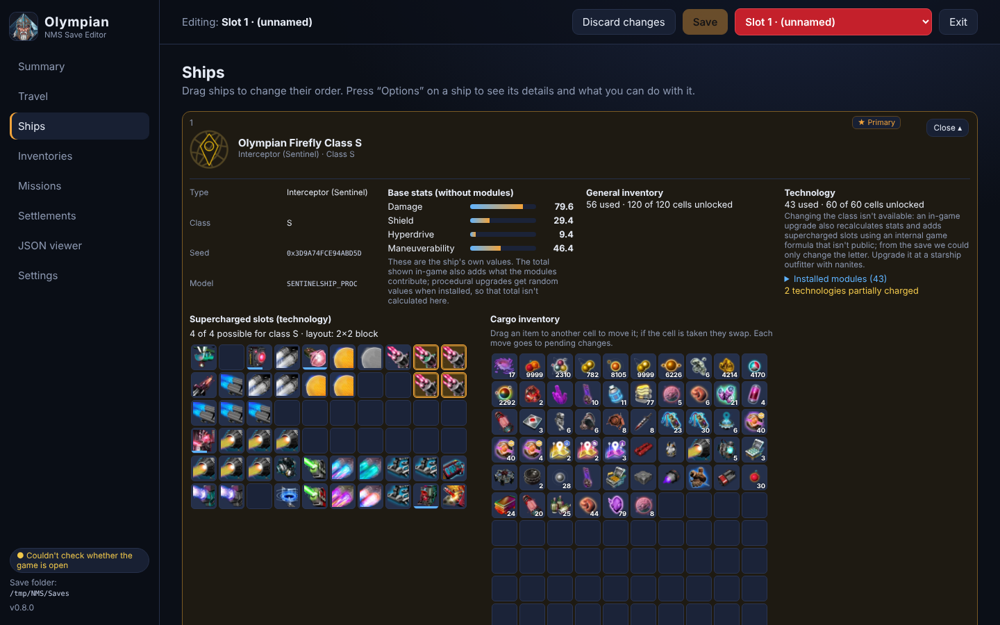
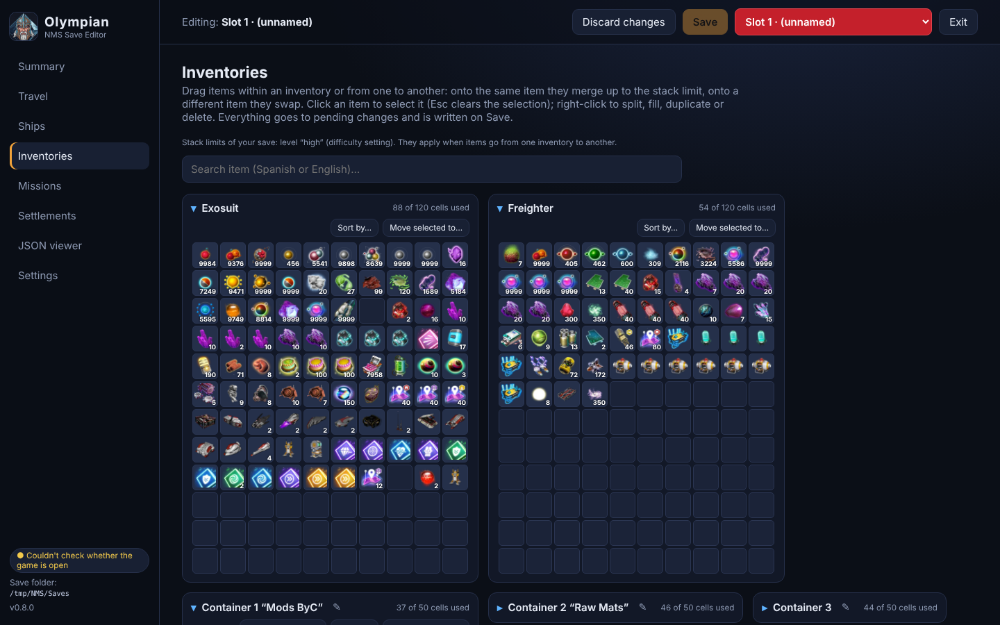
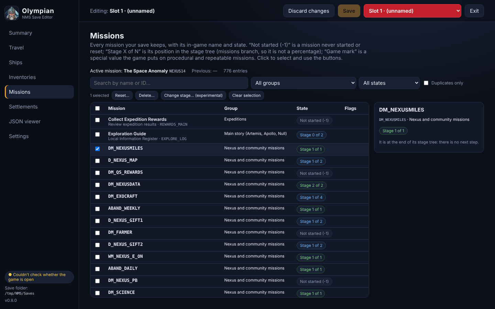
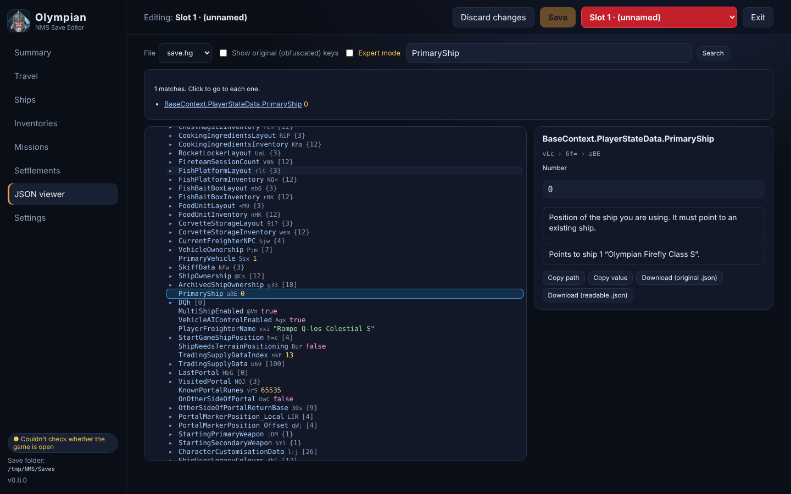

<p align="center"></p>

<h1 align="center">Olympian NMS Save Editor</h1>

<p align="center">Аккуратный наглядный редактор сохранений <b>No Man's Sky</b> для Windows.<br>
Каждое изменение сначала показывается, проверяется байт за байтом и записывается только после автоматической резервной копии.</p>

<p align="center"><a href="README.md">Read in English</a> · <a href="README.es.md">Leer en español</a> · <a href="FAQ.ru.md">Частые вопросы</a> · <a href="CHANGELOG.md">Список изменений (на английском)</a></p>



## Что нового в 0.10.0

- **Значения как в игре:** подсказка каждого процедурного улучшения показывает его точное значение, а у каждого корабля видны **потенциальный урон, прочность щита, дальность гипердвигателя и манёвренность**, как на экране корабля в игре.
- **Автосортировка технологий** кораблей и корветов: выберите один или два приоритета для суперзаряженных ячеек, остальное расставляется ради смежности.
- **Корабли:** «Сортировать по…» для груза (сначала то, что заряжает щит); копирование модулей переносит только технологии, которые принимает этот тип корабля (технологии стражей и живых кораблей заменяются эквивалентом), а **«Исправить технологии»** чинит корабли, где такие технологии уже стоят; **удаление выбранного**; **корветы** можно чинить, открывать ячейки, расширять до максимума класса S, автосортировать и **удалять, как в игре**.
- **Инвентари:** «📥 Перенести сюда все» правой кнопкой; **развернуть / свернуть все**; **удалить выбранные** сразу в нескольких инвентарях; **перетаскивание нескольких выбранных предметов** вместе.
- **Поселения:** щиты класса в стиле игры и **зелёная галочка, когда таймер истёк**.
- **Импортированные сохранения** других игроков (Steam или Xbox/Game Pass) в отдельном разделе: редактирование и возврат, **включая запись в Game Pass**.
- **Сводка и Путешествие:** репутация в виде баннеров, **медали и вехи**, ✔ у посещённых галактик, подсказки в стиле игры, **отмена / повтор**.
- Интерфейс и игровой контент на **русском**; поддержка **Linux** (Steam/Proton, Steam Deck) и **macOS**.

Полный список — в [CHANGELOG](CHANGELOG.md) (на английском).

## Почему Olympian

Большинство редакторов сохранений позволяют менять что угодно. Olympian сосредоточен на том, чтобы менять **безопасно** и объяснять, что делает каждое изменение:

- **Сначала ожидающие изменения, потом «Сохранить».** Ничего не касается ваших файлов, пока вы не нажмёте *Сохранить*. Каждое действие сначала показывает «вот что произойдёт».
- **Автоматическая резервная копия перед каждой записью** со списком того, что в ней изменилось. Она удаляется, только если вы сами очистите копии, и 10 самых новых остаются всегда. Любую копию можно восстановить в любой слот.
- **Правки с точностью до байта.** Olympian переписывает только байты того, что вы изменили; всё остальное в файле остаётся прежним. Каждое изменение проверяется: за пределами правки ничего не поменялось, а сама правка читается ровно так, как задумано. После записи файл читается заново так, как его читает игра.
- **Правила игры встроены.** Ограничения стопок, какая технология куда подходит, по одной технологии каждого вида и до трёх модулей улучшения на вид — всё взято из *ваших собственных* файлов игры.
- **Согласованные ограничения.** Некоторые вещи намеренно не предлагаются, потому что ломают игровой опыт или портят сохранения (смена класса корабля, правка показателей поселения, мгновенное завершение строительства…).

## Возможности

| Раздел | Что можно сделать |
|---|---|
| **Начальный экран** | Выбрать сохранение, сделать копию любого слота, скопировать слот в другой, восстановить любую копию в любой слот (*Восстановить в…*), удалить сохранения (с защитой). Место, занятое копиями, и очистка старых. |
| **Сводка** | Обзор сохранения, переименование, последние 10 изменений с «вернуть как было до этого изменения». Экономика, репутация, основной корабль, грузовое судно, экзокрафт, корветы и основное оружие — каждое со ссылкой на свой раздел. |
| **Путешествие** | Все 256 галактик; цель по глифам портала, галактическим координатам или вручную; появление в своём корабле в открытом космосе. |
| **Корабли** | Менять порядок перетаскиванием, выбрать основной корабль, переименовать, чинить повреждённые модули (один или все), открывать ячейки, перезаряжать, расширять груз до максимума класса (и технологии до 60, когда у корабля уже есть 4 суперзаряженные ячейки), менять сид (или взять сид другого корабля той же модели), копировать модули с другого корабля (только технологии, которые принимает этот тип корабля), исправлять неподдерживаемые технологии, автосортировка технологий, сортировка груза, удаление выбранного, дублировать, удалять. Реальные значения, как на экране корабля в игре, карта суперзаряженных ячеек и рамки бонуса смежности. Для корветов (включая удаление, как в игре) и живых кораблей показываются только безопасные для них действия. |
| **Инвентари** | Экзокостюм, грузовое судно, 10 контейнеров хранения, склад корвета, экзокрафт и груз кораблей на одном экране. Перетаскивание между инвентарями, объединение стопок, сортировка по названию/редкости/стоимости, «перенести сюда все…» по категории, поиск с итогами, разделить/заполнить/дублировать/удалить стопки, «перенести сюда все» для одного предмета, выбор нескольких предметов, чтобы перенести, перетащить или удалить их вместе, развернуть/свернуть все, добавление предметов в пустые ячейки. Установленные технологии экзокостюма, грузового судна и мультиинструментов: установка, снятие, перемещение. |
| **Задания** | Каждое задание с его названием из игры, группой и состоянием. Сброс (по желанию — и остальной цепочки), удаление застрявших или дублированных записей, смена этапа (экспериментально). Боковая панель «что делать сейчас / дальше» по текстам целей из самой игры. Задания с одинаковым названием сгруппированы. |
| **Поселения** | Только ваши поселения: показатели, бонусы с их точным эффектом, ожидающее решение, производство, строительство в процессе и 48 участков с их классом, улучшениями в процессе и галочкой, когда таймер истёк. Переименовать, убрать имеющиеся бонусы, отклонить ожидающее решение. Советник на основе данных игры (долг, слабые показатели и какие бонусы их вызывают…) и известные цепочки заданий поселения с вашим прогрессом. |
| **Просмотр JSON** | Всё сохранение в виде дерева с читаемыми названиями ключей, названия предметов рядом с ID, поиск, пояснения, что значит каждое поле и чем рискует его правка, вычисленные зависимости, экспорт. Необязательный **режим эксперта** для изменения отдельных значений (только того же типа, с проверкой, как и всё остальное). |

Языки: интерфейс на **русском, английском или испанском**, а термины игры отдельно — на английском, латиноамериканском испанском, испанском (Испания) или русском.

## Снимки экрана

| | |
|---|---|
|  |  |
|  |  |
|  |  |
|  |  |

## Требования

- **Windows 11** (Windows 10 может работать, но не проверялась), ПК-версия No Man's Sky (проверено со **Steam**; папка сохранений GOG тоже находится).
- Microsoft Edge (входит в Windows) — Olympian открывается в окне Edge в виде приложения.
- Python 3.11+ — если его нет, при первом запуске устанавливается автоматически (официальный Python 3.13, только для вашего пользователя, через `winget`).

Сохранения **Xbox / Game Pass для ПК** не открываются напрямую: импортируйте их в *Начальный экран → Импортированные сохранения* (папка игры `wgs`), редактируйте там и верните через *Экспортировать для владельца → Xbox / Game Pass* (перед записью делается копия папки `wgs`). Сохранения консолей (PlayStation, Xbox, Switch) **не** поддерживаются.

## Что Olympian NMS Save Editor делает и чего не делает

*Этот раздел — утверждённый текст автора; пока он есть только на английском и испанском.*

Every mod or editor changes the game, and Olympian NMS Save Editor is no exception. What sets it apart isn't moral superiority, but these safety commitments:

1. **It will only produce results the game could produce on its own**, following its own rules and limits. It will never leave your save in an impossible state.
2. **It will only change what is known with certainty; it will not destroy your saves.** It will not apply high-risk experimental features: we already take that risk for you, with real tests that are continuously monitored. For everything else we may show you a reading, but until a safe method is defined, we will not offer editing.
3. **It will try to keep your game experience as faithful as possible** (while still offering optional improvements). You'll see that it offers tools that solve real problems, not shortcuts to "have everything".
4. **It will put your safety first:** backups before any change to your save, as little intrusion as possible, and clear warnings when something carries risk.
5. **It will be transparent:** open source, not affiliated with Hello Games, and it will explain what each feature does and doesn't do.

## Установка и запуск

1. Скачайте последний `OlympianNMSSaveEditor_vX.Y.Z.zip` из [Releases](../../releases) и **распакуйте его** (например, в `Документы\Olympian`). Не запускайте его прямо из архива.
2. Дважды щёлкните **`run_olympian_nmsse.bat`**.
   - В первый раз он готовит своё окружение (1–3 минуты). Потом открывается сразу.
   - Рядом с `.bat` также создаётся ярлык **«Olympian NMS Save Editor»** со значком приложения; скопируйте его на рабочий стол или закрепите на панели задач.
3. **Закройте игру перед сохранением.** Olympian это проверяет и отказывается записывать, пока игра запущена.
4. **Steam Cloud:** после сохранения сначала запустите игру на *этом* ПК, чтобы Steam загрузил новую версию.

**Обновление до новой версии:** у каждого архива своя папка с версией в названии (`OlympianNMSSaveEditor_v0.10.0`). Распакуйте её как новую папку, откройте через её `.bat` и, когда всё заработает, удалите старую. Ваши настройки, защита и резервные копии хранятся не в папке приложения, так что ничего не теряется. Распаковка поверх предыдущей версии тоже работает, но может оставить старые, уже ненужные файлы.

**Linux (Steam / Proton, Steam Deck) и macOS:** нужен Python 3.11 или новее. Откройте терминал в папке приложения и введите `sh run_olympian_nmsse.sh` (в macOS также можно дважды щёлкнуть `run_olympian_nmsse.command`). Сохранения ищутся в папке Proton игры (`.../steamapps/compatdata/275850/pfx/.../HelloGames/NMS`) или в `~/Library/Application Support/HelloGames/NMS`. Окно открывается в Edge, Chrome, Chromium или Brave, если они установлены; иначе — в вашем браузере. Настройки хранятся в `~/.config/OlympianNMS` (Linux) или `~/Library/Application Support/OlympianNMS` (macOS). *Пока не проверено на реальном компьютере с игрой: если что-то не работает, пришлите нам `olympian_log.txt`.*

SmartScreen или антивирус может предупредить, потому что `.bat` не подписан: *Подробнее → Выполнить в любом случае*. Olympian запускает только локальный сервер на `127.0.0.1` с ключом на сеанс и не подключается к интернету.

## Где что хранится

В папке ваших сохранений (`%APPDATA%\HelloGames\NMS\st_<id>`):

- `_OlympianBackups\<дата>_<действие>\` — автоматические резервные копии (по одной перед каждым сохранением) и `history.json`.
- `_OlympianRestorePoints\` — копии, которые вы делаете сами.

Вне папки приложения, в `%APPDATA%\OlympianNMS\`: настройки (`settings.json`), защита PIN-кодом и кодом (`lock.json`; PIN — только как проверочное значение, секрет — в зашифрованном виде) и участки поселений, которые узнаёт Olympian (`lots.json`). Если вы выбрали дополнительную папку для копий, каждая копия также записывается в `<доп. папка>\OlympianNMS_<папка сохранений>\`.

В папке приложения: окружение Python (`.venv`, пересоздаётся, если его нет) и журнал `olympian_log.txt` рядом с `.bat`.

Папки версий до 0.7.0 (`_ZeusRespaldos`, `_ZeusPuntos`) переименовываются в новые названия автоматически при первом открытии папки сохранений; ни одна копия не теряется.

## Данные игры и обновления игры

Названия предметов, значки, ограничения стопок, таблицы заданий и правила поселений берутся из собственных файлов игры (`olympian/data/gamedata.json`, `olympian/data/icons.zip`) и создаются с помощью [`tools/build_gamedata.py`](tools/build_gamedata.py) (HGPAKtool + MBINCompiler). Olympian хранит отпечаток файлов игры, и **Настройки** сообщают, когда после патча данные устарели.

Чтобы пересобрать данные самостоятельно:

```bat
pip install hgpaktool
python tools\build_gamedata.py "<NMS>\GAMEDATA\PCBANKS" "<путь к MBINCompiler.exe>" olympian\data\gamedata.json
```

## Для разработчиков

```bat
python -m olympian            :: запуск (открывает окно)
python -m olympian --check    :: самопроверка окружения
python -m pytest tests        :: тесты
```

- `olympian/core/` — формат сохранений (`hgfile`, `savefile`, `meta`), участки JSON с точностью до байта (`jspan`, `pathedit`), все разделы редактора и система защиты (`safety`, `session`, `ops`).
- `olympian/web/` — интерфейс (обычные HTML/CSS/JS без сборки) и его тексты (`i18n/en.json`, `i18n/es.json`, `i18n/ru.json`).
- Большинство тестов работает с копиями реальных сохранений в `tests/fixture/`. Сохранения личные, поэтому их **нет** в этом репозитории; положите туда копии своей папки сохранений, чтобы запустить весь набор (тесты, которым они нужны, иначе пропускаются).

Сообщения об ошибках приветствуются в [Issues](../../issues): приложите `olympian_log.txt` и опишите, что вы делали.

## Поддержать проект

Olympian NMS Save Editor бесплатен. Если он сэкономил вам часы гринда (или спас сохранение), можете угостить MightyZeus кофе:
**[paypal.me/ImMightyZeus](https://paypal.me/ImMightyZeus)** — любая сумма помогает обновлять его после каждого патча игры. Спасибо!

## Авторы

**Разработчик: MightyZeus, родом из Никарагуа 🇳🇮.**

*Благодарности — утверждённый текст автора; пока он есть только на английском и испанском.*

```
Olympian NMS Save Editor — Copyright © 2026 MightyZeus · GPL-3.0 License
Support the project: https://paypal.me/ImMightyZeus · Repository: https://github.com/ImMightyZeus/Olympian-NMS-Save-Editor

Acknowledgements:
To my dear wife and my beloved family, for letting me keep being a kid even as an adult.
Pangro Daer Barun D'Gross, for continuing to corrupt me with video games.
Fenrir, because even though he hardly plays anymore, he's still up for talking about my adventures and misadventures.
```

Основано на работе сообщества моддеров No Man's Sky:

- [libNOM.map](https://github.com/zencq/libNOM.map) от zencq — сопоставление зашифрованных ключей сохранения (GPL-3.0; `olympian/data/mapping_mbincompiler.json`).
- [MBINCompiler](https://github.com/monkeyman192/MBINCompiler) (LGPL-3.0) и [HGPAKtool](https://github.com/monkeyman192/HGPAKtool) (MIT) от monkeyman192 и участников — чтение файлов данных игры.
- [lz4](https://github.com/python-lz4/python-lz4) (BSD) — сжатие сохранений (готовый пакет для Windows в комплекте).
- [QR Code Generator](https://github.com/kazuhikoarase/qrcode-generator) от Kazuhiko Arase (MIT) — QR-код для настройки защиты (`olympian/web/vendor/qrcode.js`).
- Знания сообщества вокруг [NomNom](https://github.com/zencq/NomNom) и [NMSSaveEditor от goatfungus](https://github.com/goatfungus/NMSSaveEditor), благодаря которым удалось понять формат сохранений.

## Отказ от ответственности

Olympian — фанатский инструмент, **не связанный с Hello Games и не одобренный ею**. *No Man's Sky* — товарный знак Hello Games. Тексты, данные и значки игры в `olympian/data/` принадлежат Hello Games и включены только для использования с вашей собственной копией игры. Вы редактируете сохранения на свой страх и риск: Olympian делает резервную копию перед каждой записью, но храните и свои копии важных сохранений.

## Использование ИИ

*Этот раздел — утверждённый текст автора; пока он есть только на английском и испанском.*

New technologies are part of the everyday work behind this and other MightyZeus projects. Olympian NMS Save Editor is developed with the help of an AI (Claude), which takes part in writing and reviewing the code; the project's direction, which features go in and which are left out on purpose, and the testing in the real game are human work.

The underlying commitment doesn't change: building real solutions and tools from the perspective of a player who is passionate about enjoying the game and helping others do the same.

## Лицензия

Copyright © 2026 MightyZeus.

Olympian — свободное программное обеспечение под лицензией [GNU General Public License v3.0](LICENSE): входящее в комплект сопоставление ключей из libNOM.map распространяется под GPL-3.0, поэтому Olympian использует ту же лицензию. Вы можете использовать, распространять и изменять его на условиях этой лицензии; распространяемые или изменённые версии должны сохранять это уведомление об авторских правах и оставаться под GPL-3.0.

## Другие проекты MightyZeus для No Man's Sky

- **Olympian NMS Save Editor**: безопасный наглядный редактор сохранений (ПК/Steam). https://github.com/ImMightyZeus/Olympian-NMS-Save-Editor
- **Olympian Planet Coords**: координаты планеты на экране, а также цели с маркером и стрелкой направления. https://github.com/ImMightyZeus/Olympian-Planet-Coords

Все проекты: https://github.com/ImMightyZeus
